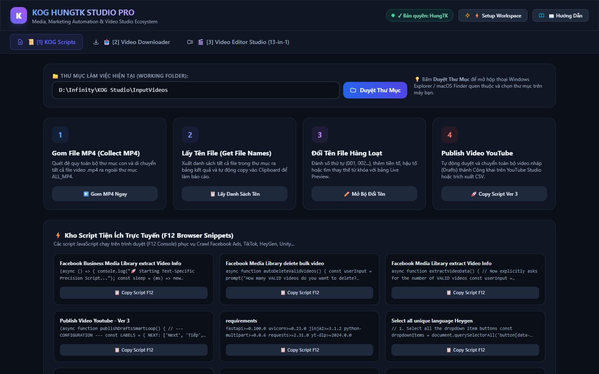
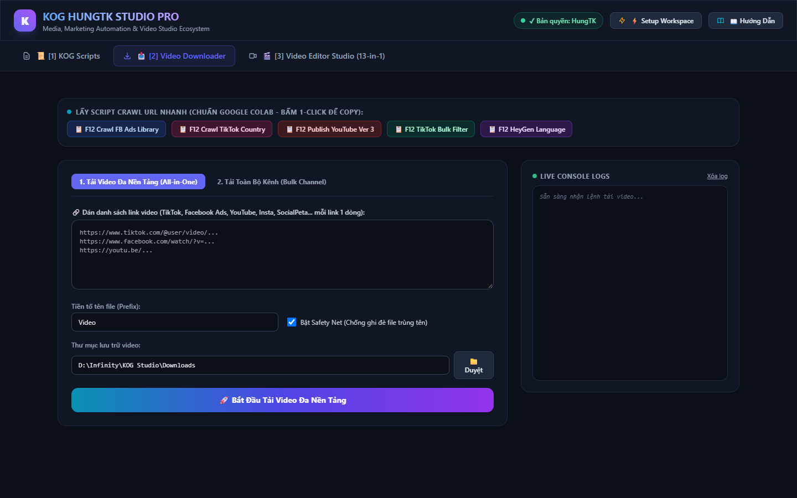
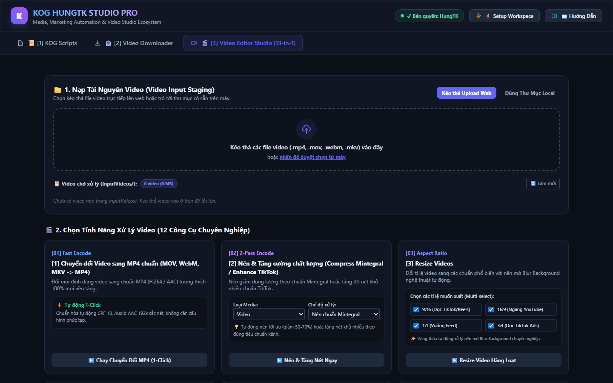

# 🚀 KOG HungTK Studio All-in-One

Hệ sinh thái công cụ tổng hợp tự động hóa, tải video đa nền tảng và dựng video chuyên nghiệp **KOG HungTK Studio**, hỗ trợ toàn diện cả **Windows** và **Apple macOS**.

---

## 🌟 3 Trụ Cột Tính Năng Chính

### 1. 📜 KOG Scripts (Công Cụ Tiện Ích & Tự Động Hóa Browser)


* **Gom MP4:** Tự động quét và gom toàn bộ file video MP4 từ mọi thư mục con ra ngoài.
* **Lấy tên file:** Trích xuất toàn bộ danh sách tên file trong thư mục ra Clipboard hoặc file txt.
* **Đổi tên hàng loạt:** Đánh số thứ tự, xóa ký tự thừa, chuẩn hóa định dạng tên file đồng loạt.
* **Publish YouTube:** Tạo danh sách liên kết publish bản nháp YouTube tự động.
* **Lọc file trùng lặp cơ bản:** Quét dọn các file trùng lặp trên ổ đĩa.
* **Kho Snippet trực tuyến:** Tự động nạp các script crawl Facebook Ads Library, TikTok, HeyGen, Unity, SocialPeta trực tiếp vào RAM và Clipboard (F12 Console).

---

### 2. 📥 Video Downloader (Tải Video Đa Nền Tảng & Toàn Bộ Kênh)


* **Tải Video Đa Nền Tảng (All-in-One):** Hỗ trợ TikTok, Facebook Ads Library, YouTube (Shorts & Long-form), Instagram, SocialPeta.
* **Bóc tách luồng CDN trực tiếp:** Kéo video từ `fbcdn.net` và SocialPeta cực nhanh qua stream I/O không qua render.
* **Chống chặn IP (Anti-Ban):** Tự động nghỉ ngẫu nhiên 3–5 giây giữa các lượt tải để chống lỗi Rate Limit 429.
* **Safety Net Protection:** Tự động thêm mã hậu tố ngẫu nhiên để chống ghi đè file trùng tên.
* **Tải Toàn Bộ Kênh (Bulk Channel):** Quét toàn bộ hoặc số lượng chỉ định video từ kênh TikTok / YouTube kèm cơ chế giả lập Smart TV / Mobile Web Client (`player_client=tv,mweb`) và hỗ trợ Cookies.

---

### 3. 🎬 Video Editor Studio (Biên Tập & Dựng Video Chuyên Nghiệp 12-in-1)


* **Chuyển đổi Fast Copy:** Đổi đuôi MOV, WebM, MKV sang MP4 chuẩn cực nhanh không mất chất lượng.
* **Tối ưu 9:16 TikTok / Reels:** Đổi tỉ lệ khung hình kèm nền mờ nghệ thuật (Blur Background).
* **Nén Mintegral & Tăng nét TikTok:** Tối ưu dung lượng 50–70% và thuật toán Unsharp Denoise.
* **Chuẩn hóa TikTok Ads Policy:** Tự động điều chỉnh độ dài, upscale bitrate $\ge 516\text{ kbps}$, scale Lanczos tối thiểu $1080\times 1920$.
* **Ghép Intro, Outro, Khung viền & Logo:** Chèn logo, chèn frame viền trong suốt và nối video.
* **Tráo Visual Hook (A/B Testing):** Ghép 3s hook đầu video và giữ nguyên luồng audio nền.
* **Trích xuất Frame ảnh độ nét cao:** Chụp ảnh Thumbnail sắc nét hàng loạt hoặc thủ công.
* **Xử lý Audio:** Trích xuất MP3, thay nhạc nền, hòa trộn âm thanh.
* **Phân loại ngôn ngữ (Whisper AI):** Tự động nhận diện ngôn ngữ nói và gom video theo thư mục.
* **Cắt gọt Video (Trim):** Cắt bỏ đoạn đầu và đoạn đuôi theo giây.
* **Smart Stream Deduplicator:** Quét băm riêng luồng Video và Audio để lọc trùng mà không xóa nhầm bản lồng tiếng đa ngôn ngữ.
* **Dọn dẹp & Lưu trữ (Archive):** 1-Click dọn dẹp và lưu trữ dự án theo ngày giờ.

---

## 🖥️ Hướng Dẫn Cài Đặt & Sử Dụng (Standalone - Không Cần Cài Python)

KOG HungTK Studio hiện đã được đóng gói thành các gói phần mềm độc lập siêu nhẹ (~18–20 MB), **bảo mật 100% mã nguồn** và **không cần cài đặt Python hay bất kỳ thư viện môi trường nào**.

---

### 🍎 Dành Cho Máy Apple macOS (M1/M2/M3/M4 & Intel)

#### Cách 1: Cài đặt & Khởi chạy tự động bằng 1 dòng lệnh (Khuyên dùng)
1. Mở ứng dụng **Terminal** trên máy Mac (Nhấn `Cmd + Space` -> gõ `Terminal` -> ấn `Enter`).
2. Copy và Paste **nguyên dòng lệnh bên dưới** vào Terminal rồi nhấn `Enter`:

```bash
/bin/bash -c "$(curl -fsSL https://raw.githubusercontent.com/KOG-KH/KOG-HungTK-Studio-Releases/main/install_macos.sh)"
```

✨ **Lệnh sẽ tự động thực hiện tất cả:**
* Tự động tải bản macOS mới nhất về thư mục riêng `~/KOG_HungTK_Studio`.
* Tự động giải nén file chương trình.
* Cấp quyền thực thi (`chmod +x`) và gỡ bỏ kiểm duyệt bảo mật macOS Gatekeeper (`xattr -cr`).
* **Tự động tạo icon `KOG HungTK Studio.command` ngay trên màn hình Desktop**.
* Khởi chạy Web App và tự mở trình duyệt web `http://127.0.0.1:8000`.

> 💡 **Khởi động những lần tiếp theo:** Chỉ cần ra màn hình Desktop và nhấp đúp vào icon **`KOG HungTK Studio.command`** là xong!

#### Cách 2: Tải file thủ công từ Releases
1. Tải file **[KOG_Studio_macOS.zip](https://github.com/KOG-KH/KOG-HungTK-Studio-Releases/releases/latest/download/KOG_Studio_macOS.zip)** về thư mục `Downloads`.
2. Mở **Terminal** và dán lệnh sau để tự động giải nén, cấp quyền và chạy:
```bash
cd ~/Downloads && unzip -o KOG_Studio_macOS.zip && chmod +x KOG_Studio && xattr -cr KOG_Studio && ./KOG_Studio
```

---

### 🪟 Dành Cho Máy Windows (Windows 10, 11 64-bit)

1. Tải trực tiếp file: **[KOG_Studio.exe](https://github.com/KOG-KH/KOG-HungTK-Studio-Releases/releases/latest/download/KOG_Studio.exe)** *(hoặc bản zip [KOG_Studio_Windows_x64.zip](https://github.com/KOG-KH/KOG-HungTK-Studio-Releases/releases/latest/download/KOG_Studio_Windows_x64.zip))*.
2. Nhấp đúp chuột vào file **`KOG_Studio.exe`** để khởi động ngay.
3. Trình duyệt web sẽ tự động mở giao diện điều khiển tại: `http://127.0.0.1:8000`.

---

## 🔒 Bản Quyền & Xác Thực Thiết Bị (Device ID)
* Toàn bộ mã nguồn Python được biên dịch đóng gói độc lập, không lộ code ra ngoài.
* Tích hợp Cổng bảo mật Google Apps Script Gateway (Zero-Token Client Architecture).
* Xác thực theo Hardware UUID (Device ID) phần cứng của người dùng trên Google Sheet của Admin.

> 📢 **CẤP QUYỀN CHO THIẾT BỊ MỚI:**
> Người dùng vui lòng liên hệ **HungTK** qua **Discord**, cung cấp:
> 1. **User Name** (Tên người dùng của bạn)
> 2. **Device ID** (Mã phần cứng UUID hiển thị trên ứng dụng hoặc lệnh kiểm tra)
> 
> *Cách lấy nhanh Device ID:*
> - **Trên macOS:** Mở Terminal gõ: `ioreg -rd1 -c IOPlatformExpertDevice | grep IOPlatformUUID`
> - **Trên Windows:** Mở PowerShell gõ: `(Get-CimInstance Win32_ComputerSystemProduct).UUID`
