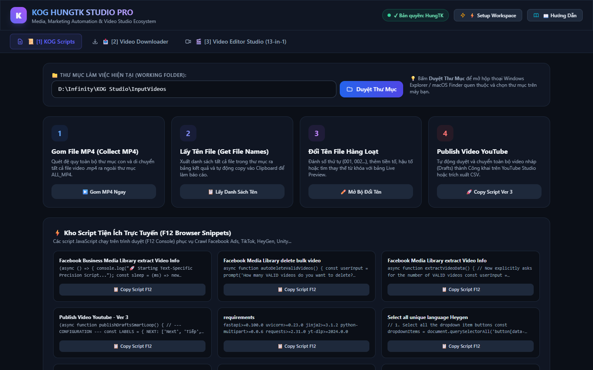
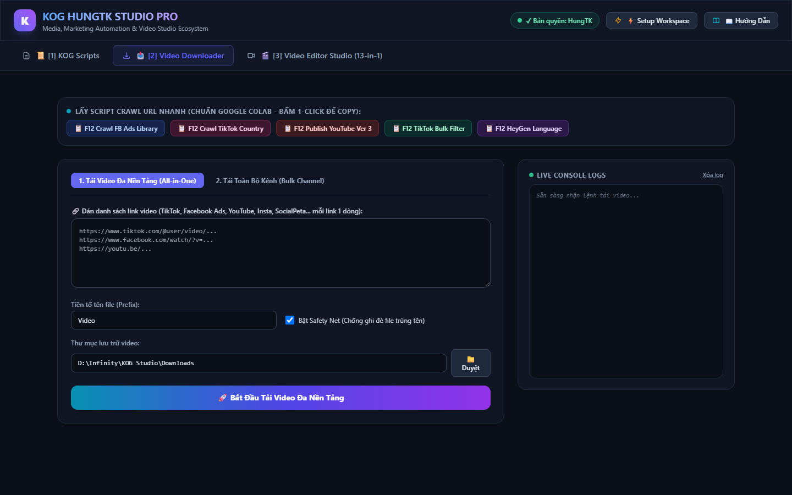
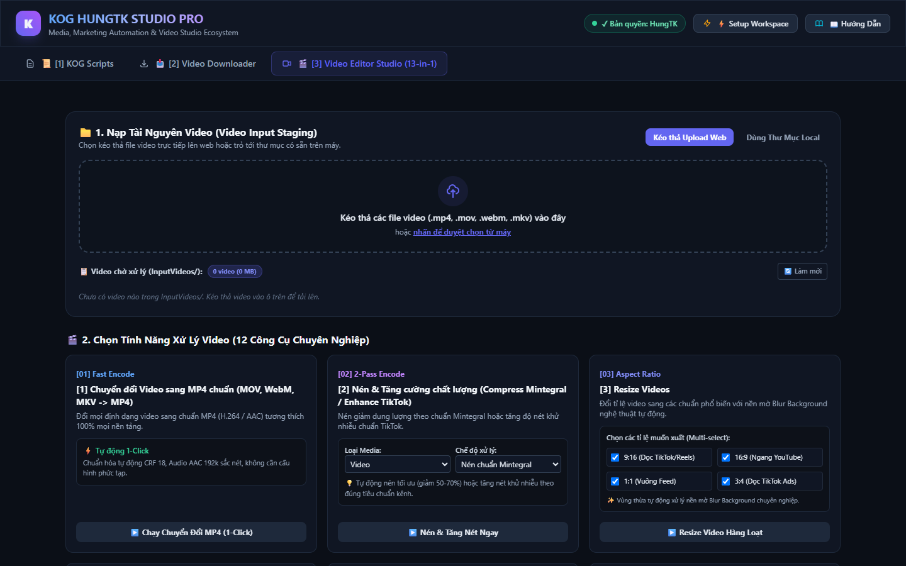

# 🚀 KOG HungTK Studio Pro

Bộ công cụ All-in-One tự động hóa **Tải video đa nền tảng**, **Sản xuất video hàng loạt**, **Spying Ads** và **Bản địa hóa nội dung toàn cầu** chuyên nghiệp dành riêng cho **Marketer, Media Buyer & Content Creator**, hỗ trợ mượt mà trên cả **Windows** và **Apple macOS**.

> ⚡ **Tự động hóa 90% công việc thủ công:** Spying & tải trọn bộ video quảng cáo của đối thủ, tự động tráo 3s Hook đầu video để A/B testing camp, chuẩn hóa video tỷ lệ 9:16 nét căng sẵn sàng chạy Ads TikTok / Reels / Shorts chỉ với vài cú click chuột.

---

## 🌟 6 Trụ Cột Tính Năng Đột Phá Dành Cho Marketer & Creator

### 1. 📜 KOG Scripts (Tiện Ích & Tự Động Hóa Dữ Liệu Nhanh)


* **Gom video 1-Click:** Tự động quét và gom toàn bộ file video MP4 nằm rải rác ở hàng trăm thư mục con ra một nơi duy nhất.
* **Đổi tên hàng loạt linh hoạt (Custom Numbering):**
  - Tự chọn định dạng số thứ tự: `1, 2, 3...`, `01, 02, 03...`, hoặc `001, 002, 003...`.
  - Tùy biến thêm tiền tố/hậu tố, xóa ký tự rác, chuẩn hóa tên file đồng loạt cho chiến dịch quảng cáo.
* **Xuất danh sách file:** Trích xuất nhanh toàn bộ tên file trong thư mục ra Clipboard hoặc file `.txt` để tiện quản lý và lập kế hoạch nội dung.
* **Publish YouTube Draft:** Tự động tạo danh sách liên kết đăng bản nháp YouTube siêu tốc.
* **Dọn dẹp file trùng:** Quét dọn các file trùng lặp giúp giải phóng không gian ổ đĩa.
* **Kho Snippet Spying trực tuyến:** Tự động nạp các script crawl data từ Facebook Ads Library, TikTok, HeyGen, Unity, SocialPeta trực tiếp vào Clipboard (F12 Console).

---

### 2. 📥 Video Downloader (Tải Video Sạch & Spying Ads Toàn Bộ Kênh)


* **Tải Video Đa Nền Tảng (All-in-One):** Tải video sạch không logo/watermark từ TikTok, Facebook Ads Library, YouTube (Shorts & Video dài), Instagram, SocialPeta.
* **Bóc Tách Dữ Liệu Gốc Siêu Tốc:** Bóc tách dữ liệu CDN gốc từ Facebook Ads và SocialPeta cực nhanh, tải trực tiếp không cần render lại.
* **Tải Trọn Bộ Facebook Ads Library:** Dán trực tiếp link tìm kiếm từ Ads Library để quét và tải hàng loạt toàn bộ video quảng cáo của đối thủ hoặc ngành hàng.
* **Tải Trọn Bộ Kênh (Bulk Channel Downloader):**
  - Quét tải toàn bộ hoặc số lượng chỉ định video từ kênh TikTok, kênh YouTube.
  - Hỗ trợ tùy chọn **Tự động đặt tên theo tiền tố** (`Video 01.mp4`, `Video 02.mp4`...) hoặc giữ nguyên tên gốc.
* **Cơ Chế Chống Chặn IP Thông Minh (Anti-Rate Limit):** Tự động căn chỉnh thời gian nghỉ giữa các lượt tải để chống bị chặn IP, tự động thêm mã nhận diện tránh ghi đè file cũ.
* **Chuỗi Xử Lý Tự Động Ngay Khi Tải Về (Post-Download Pipeline):**
  - ✨ **[Mặc định BẬT] Tự động Tăng Nét (Enhance):** Tự động phát hiện video mờ ($< 1080\times 1920$) và áp dụng bộ lọc nâng nét, khử vỡ hình chuẩn TikTok.
  - 📐 **[Tùy chọn] Tự động Chuyển 9:16 Khung Dọc:** Video ngang/vuông sẽ tự động được đưa về tỷ lệ 9:16 dọc với nền mờ (Blur Background) sang chảnh, tự động xóa file gốc không phù hợp.
  - 🌐 **[Tùy chọn] Phân loại video theo Ngôn ngữ:** Tự động nhận diện tiếng nói (Whisper AI) và phân chia video vào các thư mục ngôn ngữ tương ứng (Anh, Việt, Thái, v.v.).
  - 🛡️ **Tự động Lọc trùng lặp thông minh:** So khớp dữ liệu luồng video, tự động phát hiện và loại bỏ các video đã có trong kho lưu trữ.

---

### 3. 🎬 Video Editor Studio (Xưởng Biên Tập & Nhân Bản Video 13-in-1)


1. **Tráo Visual Hook 3 giây đầu (A/B Testing đỉnh cao):** Tự động ghép các đoạn mở đầu 3s (Hook) hấp dẫn vào video gốc trong khi âm thanh nền vẫn chạy liền mạch — giải pháp hoàn hảo để nhân bản hàng chục mẫu quảng cáo test CTR.
2. **Siêu nén video cho Ads Network (Mintegral / Unity):** Tối ưu giảm dung lượng 50–70% nhưng vẫn giữ độ nét sắc sảo, tải cực nhanh trên các mạng quảng cáo (< 3 MB / < 5 MB).
3. **Chuẩn hóa đạt chuẩn TikTok Ads Policy:** Tự động điều chỉnh độ dài, upscale bitrate $\ge 516\text{ kbps}$, scale nét tối thiểu $1080\times 1920$ giúp video được duyệt nhanh và không bị bóp reach.
4. **Tối ưu chuẩn 9:16 TikTok / Reels / Shorts:** Chuyển đổi mọi tỷ lệ video sang khung dọc 9:16 kèm nền mờ nghệ thuật; tự động copy video chuẩn vào thư mục thành phẩm.
5. **Đổi đuôi siêu tốc (Fast Copy):** Chuyển đuôi MOV, WebM, MKV sang MP4 chuẩn chỉ trong 1 giây, hoàn toàn không giảm chất lượng.
6. **Đóng khung, Chèn Logo & Ghép Intro/Outro:** Gắn logo thương hiệu, chèn khung viền trong suốt và nối đầu/đuôi video tự động hàng loạt.
7. **Trích xuất ảnh Thumbnail nét cao:** Chụp các khung hình đẹp nhất làm ảnh bìa hàng loạt hoặc thủ công.
8. **Cắt gọt Video (Trim):** Cắt bỏ đoạn đầu và đoạn đuôi theo từng giây chuẩn xác.
9. **Biên tập Âm thanh (Audio):** Tách nhạc MP3, thay nhạc nền, phối âm thanh dễ dàng.
10. **Phân loại ngôn ngữ tự động (Whisper AI):** Nhận diện giọng nói và phân loại video vào thư mục từng quốc gia.
11. **Lọc trùng lặp thông minh:** Quét tách biệt luồng hình và tiếng để lọc video trùng mà không xóa nhầm các bản lồng tiếng đa ngôn ngữ.
12. **Dọn dẹp & Đóng gói lưu trữ (Archive):** 1-Click dọn dẹp và lưu trữ dự án ngăn nắp theo thứ tự chữ cái A-Z.
13. **Tăng tốc video hàng loạt (Batch Video Speed Up):** Tăng tốc độ video mượt mà (1.1x, 1.25x, 1.5x) mà không làm méo tiếng.

---

### 4. 🌍 Localize Studio (Bản Địa Hóa, AI Dubbing & Phụ Đề Đa Nền Tảng)
* **Lồng tiếng AI Đa Ngữ (300+ Giọng Bản Xứ):** Tự động bóc tách âm thanh lời thoại gốc với Whisper AI, sinh giọng đọc lồng tiếng bản xứ tự nhiên bằng **Edge-TTS Neural (Miễn Phí 100%)** hoặc **ElevenLabs API** siêu cảm xúc.
* **5 Phong Cách Kịch Bản Chuẩn Google Play / App Store:** Dịch thuật tự nhiên theo 5 văn phong phổ quát: *Giới Thiệu Sản Phẩm, Hướng Dẫn Sử Dụng (Tutorial), Bán Hàng (CTA), Hóm Hỉnh, Tự Nhiên*.
* **3 Preset Phụ Đề Động Chuyên Biệt:**
  - **YouTube Clean (US/Europe):** Phụ đề thanh lịch, dải nền mờ đen chuẩn CC quốc tế, tối ưu kéo view Mỹ & Châu Âu.
  - **TikTok Dynamic:** Chữ Vàng viền đen to rõ, vị trí trung tâm, nhảy từ bắt mắt kích thích giữ chân người xem.
  - **Facebook Reels Standard:** Font Arial đậm viền đen dày, né vùng nút like/share trên giao diện Reels.
* **Tùy Chọn Xuất File Linh Hoạt:** Xuất video MP4 hoàn chỉnh kèm tùy chọn xuất thêm file `.srt` phụ đề rời, file audio `.mp3` hoặc file kịch bản `.txt` vào thư mục `LocalizedVideos/`.

---

### 5. 📊 Pacing Studio & Google Sheets Sync (Đồng Bộ Doanh Thu & Báo Cáo Camp)
* **Bóc tách báo cáo chiến dịch tự động:** Nhập file báo cáo chiến dịch (CSV/Excel) từ các mạng quảng cáo để tự động tính toán Pacing, ngân sách và tốc độ phân phối.
* **Đồng bộ hóa 1-Click lên Google Sheets:** Tự động tạo và cập nhật các bảng tính Google Sheets hàng ngày cho cả team cùng theo dõi tiến độ chi tiêu và hiệu quả chiến dịch trong thời gian thực.
* **Không yêu cầu kỹ thuật:** Giao diện trực quan, tự động định dạng số liệu, biểu đồ rõ ràng cho Media Buyer.

---

### 6. 🤖 KOG AI Assistant (Trợ Lý AI Dành Riêng Cho Marketer)
* **KOG Marketer Brain v2.0:** Am hiểu sâu về chuẩn video TikTok Ads, chuẩn nén mạng Mintegral (< 3 MB), tư vấn ý tưởng kịch bản Hook 3s đầu thu hút khách hàng và mẹo tối ưu chiến dịch.
* **Tùy chọn kết nối Google Gemini:** Hỗ trợ kết nối mô hình Gemini AI thế hệ mới để mở rộng khả năng sáng tạo kịch bản, viết caption và phân tích đối thủ.
* **Giao diện đa nhiệm tiện lợi:** Dễ dàng truy cập qua Tab chuyên dụng hoặc mở cửa sổ trượt nhanh (Slide-over Drawer) bằng nút tròn nổi bất kỳ lúc nào trên màn hình.

---

## ⚙️ Trải Nghiệm & Tối Ưu Hóa Hiệu Năng Vượt Trội

* 🔄 **Tự động cập nhật ngầm 100% (Silent In-Place Auto Updater):** Ứng dụng tự động kiểm tra, tải bản cập nhật ngầm và tráo đổi phiên bản mới trong 1 giây mà không làm gián đoạn công việc của bạn.
* 🎥 **Tích hợp FFmpeg tự động (Zero-Dependency):** Tự động cấu hình bộ công cụ `ffmpeg` & `ffprobe` độc lập cho cả Windows và macOS ngay lần đầu mở app — người dùng không cần cài đặt thủ công.
* 🍏 **Tăng tốc phần cứng Apple Silicon (VideoToolbox & Metal):** Tự động kích hoạt bộ tăng tốc phần cứng của chip M1/M2/M3/M4 khi biên tập video (nhanh gấp 3-5 lần, tiết kiệm pin, máy luôn mát) và tăng tốc Whisper AI qua GPU Metal.
* 🪟 **Chế độ No-Console 100% (Windows & macOS):** Ứng dụng chạy nền hoàn toàn sạch sẽ, ẩn 100% cửa sổ dòng lệnh đen CMD/Terminal (trên macOS chạy qua Native .app); tắt ứng dụng an toàn chỉ với 1 nút bấm trên giao diện Web.
* 🐛 **Hỗ trợ kỹ thuật 1-Click:** Tự động tổng hợp thông số video (`ffprobe`) cùng log tác vụ gửi trực tiếp tới kênh kỹ thuật nội bộ chỉ với 1 cú click chuột.

---

## 💻 Hướng Dẫn Tải & Mở Ứng Dụng (Độc Lập - Không Cần Cài Python)

KOG HungTK Studio đã được đóng gói thành phần mềm độc lập siêu nhẹ (~18–20 MB), **không cần cài đặt Python hay bất kỳ môi trường kỹ thuật nào**.

---

### 🍏 Dành Cho Máy Apple macOS (M1/M2/M3/M4 & Intel)

#### Cách 1: Cài đặt & Khởi chạy tự động bằng 1 dòng lệnh (Khuyên dùng)
1. Mở ứng dụng **Terminal** trên Mac (Nhấn `Cmd + Space` -> gõ `Terminal` -> ấn `Enter`).
2. Copy và Paste **nguyên dòng lệnh bên dưới** vào Terminal rồi nhấn `Enter`:

```bash
/bin/bash -c "$(curl -fsSL https://raw.githubusercontent.com/KOG-KH/KOG-HungTK-Studio-Releases/main/install_macos.sh)"
```

✨ **Lệnh sẽ tự động thực hiện tất cả cho bạn:**
* Tự động tải bản macOS mới nhất về thư mục riêng `~/KOG_HungTK_Studio`.
* Tự động giải nén và cấp quyền chạy.
* **Tự động tạo biểu tượng `KOG HungTK Studio.app` ngay trên màn hình Desktop**.
* Khởi chạy ứng dụng và tự mở trình duyệt web giao diện làm việc tại `http://127.0.0.1:8000`.

> 💡 **Khởi động những lần tiếp theo:** Chỉ cần ra màn hình Desktop và nhấp đúp vào ứng dụng **KOG HungTK Studio.app** là xong!

#### Cách 2: Tải file thủ công từ Releases
1. Tải file **[KOG_Studio_macOS.zip](https://github.com/KOG-KH/KOG-HungTK-Studio-Releases/releases/latest/download/KOG_Studio_macOS.zip)** về thư mục `Downloads`.
2. Mở **Terminal** và dán lệnh sau để giải nén và khởi chạy:
```bash
cd ~/Downloads && unzip -o KOG_Studio_macOS.zip && chmod +x KOG_Studio && xattr -cr KOG_Studio && ./KOG_Studio
```

---

### 🪟 Dành Cho Máy Windows (Windows 10, 11 64-bit)

1. Tải trực tiếp file: **[KOG_Studio.exe](https://github.com/KOG-KH/KOG-HungTK-Studio-Releases/releases/latest/download/KOG_Studio.exe)** *(hoặc tải bản zip [KOG_Studio_Windows_x64.zip](https://github.com/KOG-KH/KOG-HungTK-Studio-Releases/releases/latest/download/KOG_Studio_Windows_x64.zip))*.
2. Nhấp đúp chuột vào file **`KOG_Studio.exe`** để mở ứng dụng ngay lập tức.
3. Trình duyệt web sẽ tự động mở giao diện điều khiển tại: `http://127.0.0.1:8000`.
   * **Giao diện sạch sẽ (No-Console):** Ứng dụng chạy ngầm hoàn toàn, **không hiện cửa sổ dòng lệnh đen**.
   * **Tắt ứng dụng an toàn:** Khi dùng xong, bạn chỉ cần bấm nút **🔴 Tắt App** ở góc trên thanh điều khiển của Web App.
